# Screenshots

*Русская версия: [SCREENSHOTS.ru.md](SCREENSHOTS.ru.md).*

Every screen of the window, in English and in Russian. The layout rules behind them are in
[UI.md](UI.md); every action shown here has a command-line counterpart in [README.md](../README.md).

The screens were taken on a **demo catalogue**: 94 stock photos (Pexels) indexed in a temporary
cache, with five demo albums and seven demo names for the face groups (Anna, Maria, Vera, Olga,
Dmitry, Sofia, Ilya). The names are labels for the screenshots, not real identities. The shooting
dates were spread over 2016–2026 (demo EXIF), so the calendar shows an archive of eleven years;
personal paths in the screenshots are blurred.

## Contents

- [Main screen](#main-screen)
- [Search](#search)
- [Tag filter](#tag-filter)
- [Full-screen viewer](#full-screen-viewer)
- [People](#people)
- [Albums](#albums)
- [Calendar](#calendar)
- [Duplicates & series](#duplicates--series)
- [Trash](#trash)
- [Integrity](#integrity)
- [Settings](#settings)

## Main screen

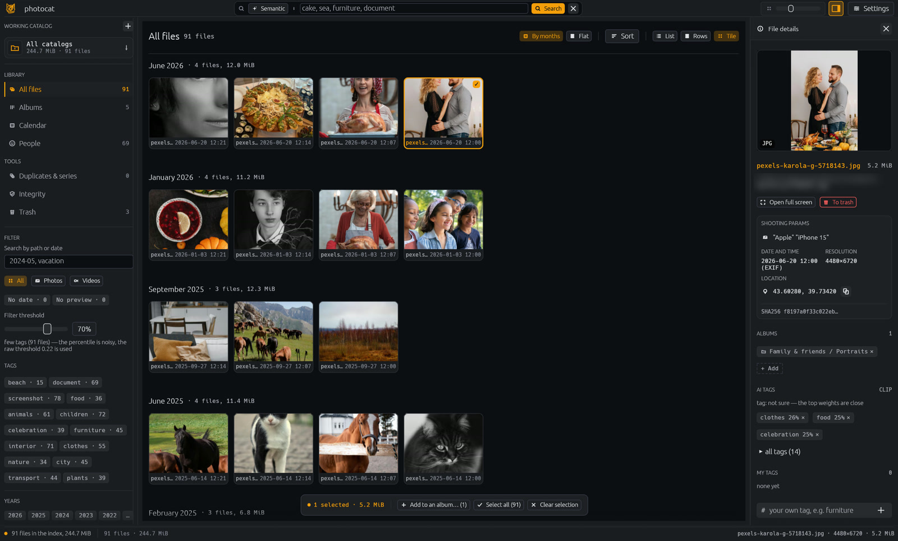

The archive after indexing. The grid is grouped by month and answers "what is in the archive" before
anything is clicked: the previews, the number of files and the volume of each month. The left panel
holds the working catalog, the library (all files, albums, calendar, people), the tools (duplicates,
integrity, trash), the path/date field, the type switches, the tag threshold and the tag cloud, and
the years of the archive. Three cell views — tiles, rows and a list — share one size slider
(UI.md § "The ribbon").

The right panel is the file card of the selected photo: the preview, the path, **Open full screen**
and **To trash**, the shooting parameters, the sha256, the albums it belongs to, the CLIP tags with
their weights (a tag is a filter: a click adds it to the grid filter) and the owner's own tags. The
bar at the bottom is the selection: how many are picked, their size, and **Add to an album**.

## Search

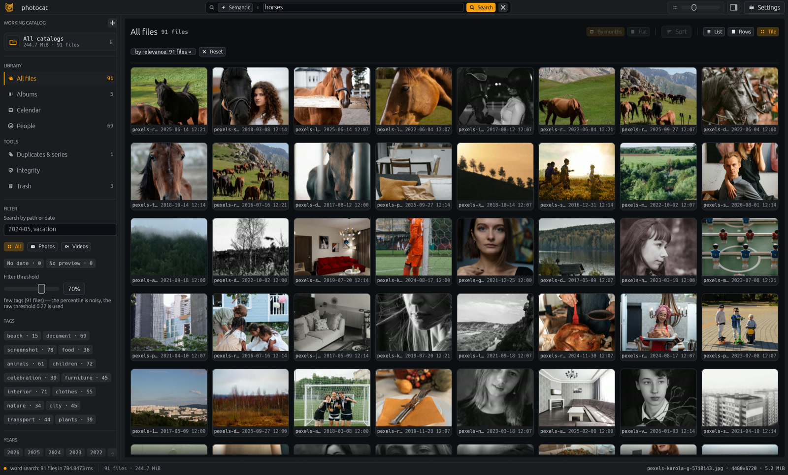

**Semantic** finds by meaning, not by file name: the query goes through the text tower of the CLIP
model, the photos through the image tower, and only the vectors are compared. The results are
ordered by relevance and the chip above the grid says so; **Reset** returns to the archive order. The
same field searches the recognized text with **By text** (the `ocr` pass). The status bar names the
pass and its time.

Searching never sends anything anywhere: the query and the vectors stay on the machine.

## Tag filter

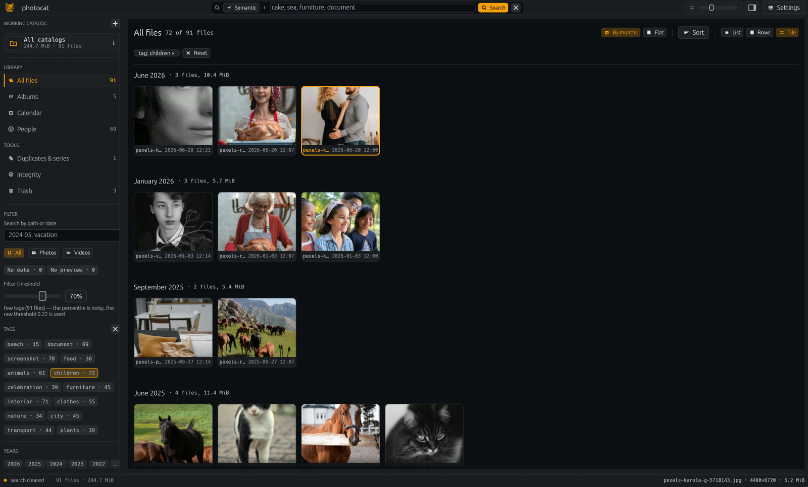

A click on a tag in the left panel filters the grid. Tags accumulate (the intersection: every picked
tag has to pass), each chip has its own **×**, and the threshold slider above the cloud is a
percentile of the archive — with few tagged files it says so honestly. The same filter exists in the
CLI: `photocat tags` edits the dictionary, `embed --retag` recomputes the tags from stored vectors
without touching the photos.

## Full-screen viewer

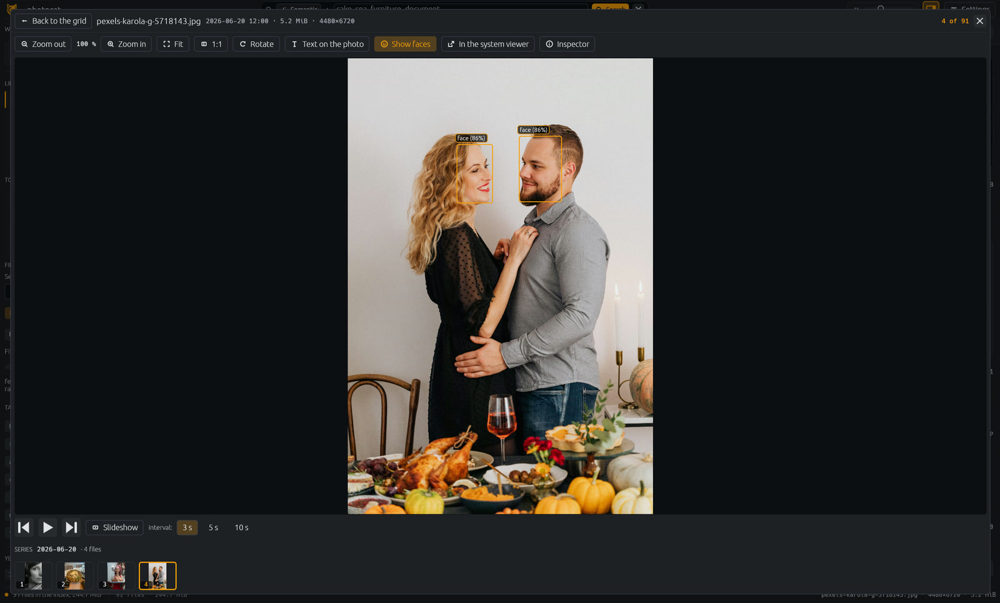

One photo, the whole window. The header names the file, its date, size and resolution and the
position in the set; the tools row zooms, fits, turns to 1:1, rotates, runs OCR on the visible
frame, shows the detected faces, hands the file to the system viewer and opens the inspector. The
series strip under the photo is the same day: the previous and next frame are one click or one arrow
key away, and the slideshow goes through the set with a chosen interval. Codecs outside the player's
scope are refused with the reason; nothing is started without an explicit press.

## People

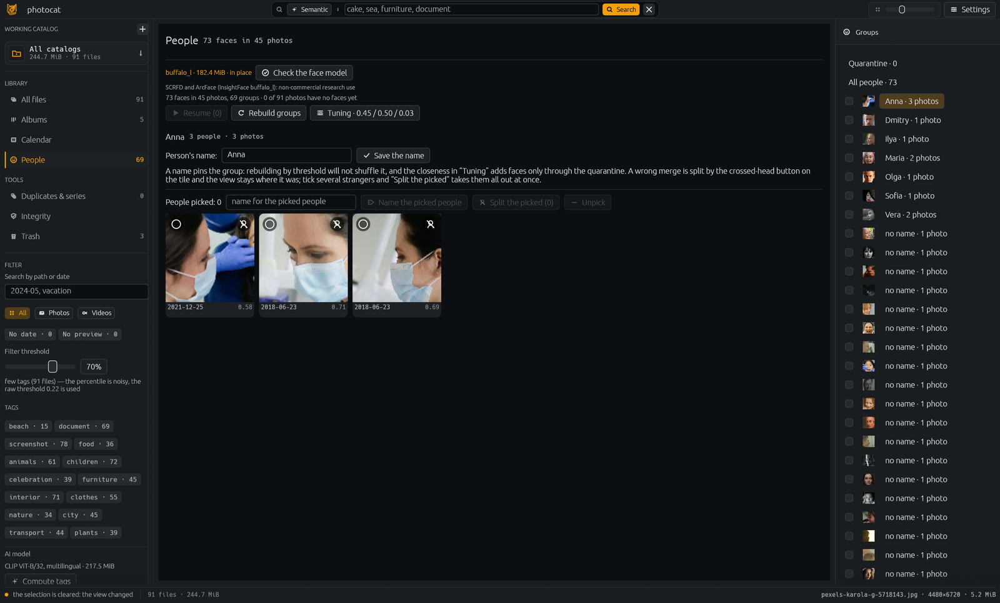

SCRFD finds the faces, ArcFace embeds them, and the vectors are clustered. A group is a person once
the owner names it; the name is stored in the DB and survives a rebuild. A wrong merge is split with
the crossed-head target on the tile, the ticked strangers leave in one press, and the matching
sliders live behind **Tuning**. An automatic match to an already named person is only a proposal: it
waits in the **Quarantine** until the owner confirms it (M26.17). Faces are processed locally; the
model weighs 182.4 MiB and is downloaded only with consent.

## Albums

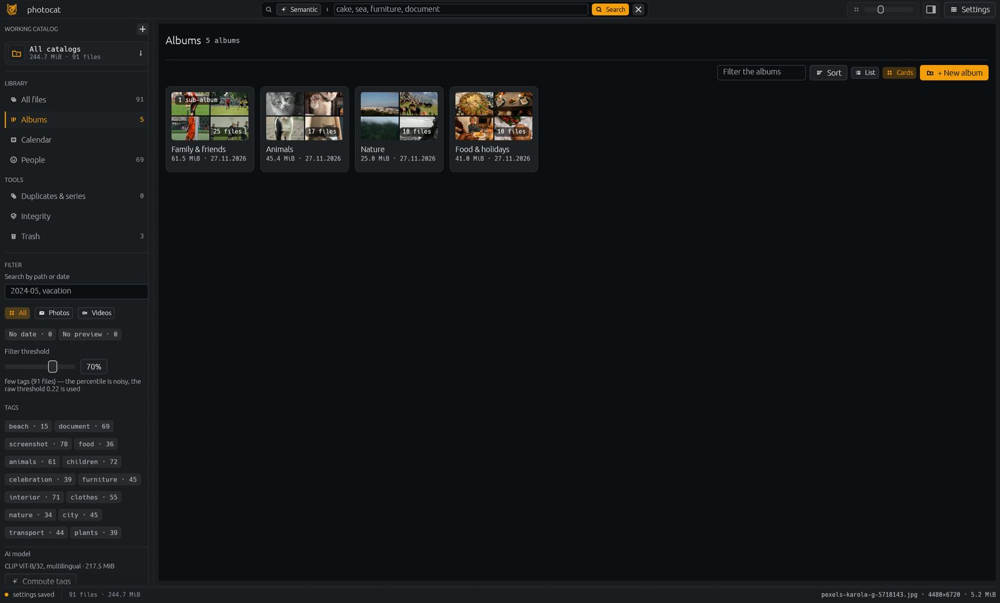

An album is a tree and an order, and only DB rows: nothing on disk moves. The cards at the root show
the name, the number of files, sub-albums and volume; the cover is a mosaic of up to four of the
album's first photos. The control row filters the albums, sorts them and switches between cards and
a list.

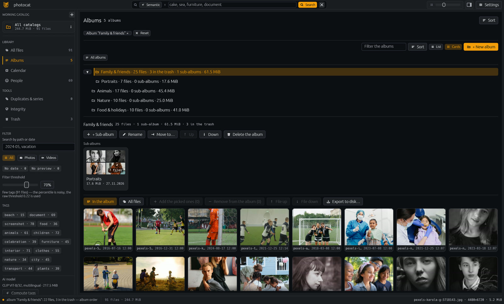

Inside an album the tree stays on screen and every row is one click target. A sub-album is a card
with its own mosaic. The photos below keep the album order, **File up** / **File down** move them,
**In the album / All files** switches the grid, and **Export to disk…** writes real copies (structure
and order as in the album) only after the explicit `--apply`; the archive itself is never touched.

## Calendar

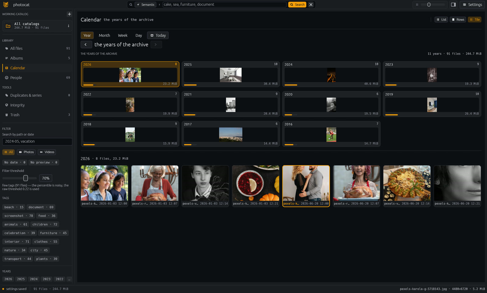

The top layer of the calendar: every year of the archive with the number of files, the volume and a
preview of one of its days. The layers below are the twelve months of a year, the weeks of a month and
the days of a week; the photos of the period stand under the tiles, so a day can be opened without
losing the overview. An empty month is an honest zero.

## Duplicates & series

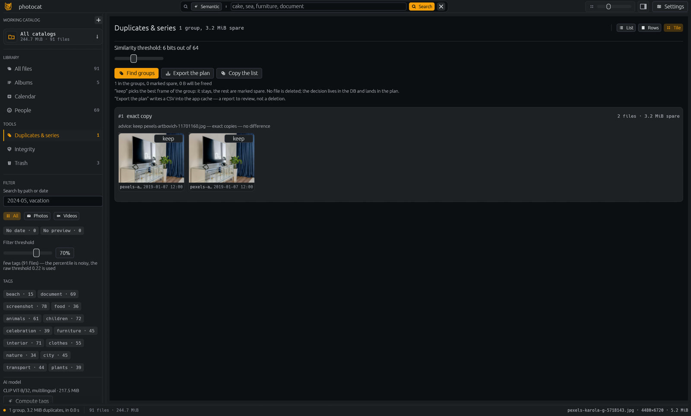

The threshold is a Hamming distance over the 64-bit dHash. **Find groups** compares the hashes and
builds the groups; **keep** marks the frame that stays, the rest are marked spare — the decision is
stored in the DB and exported as a CSV plan, no file is deleted. Exact copies are recognized by
sha256 and labelled separately, because for them there is no reason to choose. The screen also
warns that a low threshold still produces false pairs.

## Trash

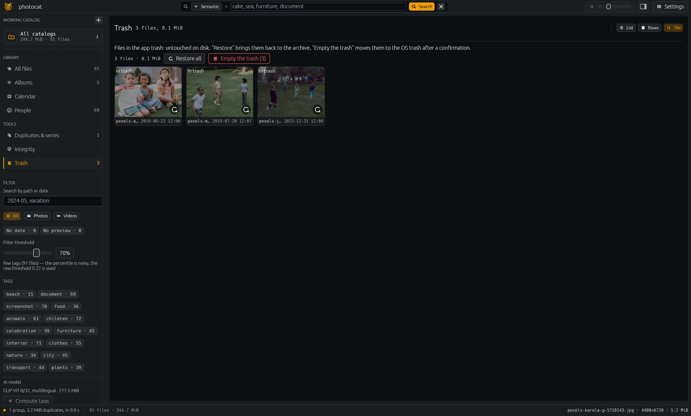

The app trash is a mark in the DB: the files are untouched on disk, hidden from the ordinary views,
and **Restore** brings them back. **Empty the trash** is the one action that changes the disk — it
moves the files to the OS trash, and only after a confirmation. There is no permanent deletion in
photocat. The header counts the files and their volume.

## Integrity

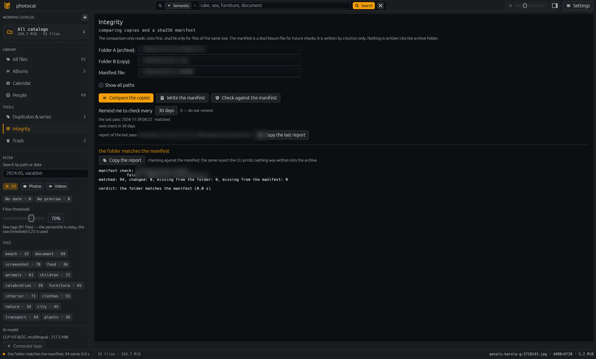

**Compare copies** compares two folders: size first, sha256 only for equal sizes. **Write the
manifest** makes a `sha256sum`-format snapshot, and **Check against the manifest** verifies a folder
against it. All three are read-only for the archive; the report is written to the cache and can be copied.
The last pass and the next reminder are on the same screen.

## Settings

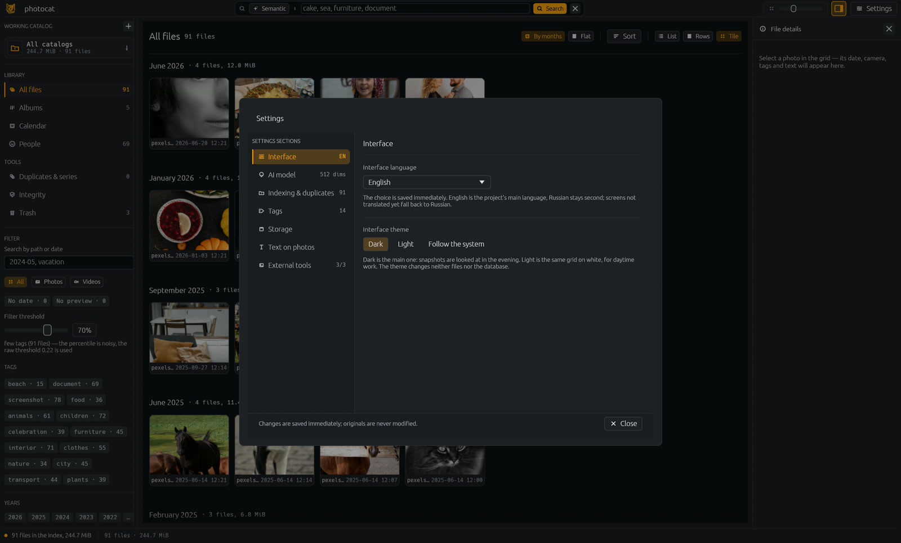

The interface language and theme are chosen here; a change is saved immediately. The theme changes
neither files nor the database. The other sections hold the model, indexing and duplicates, the tag
dictionary, storage, text on photos and the external programs.

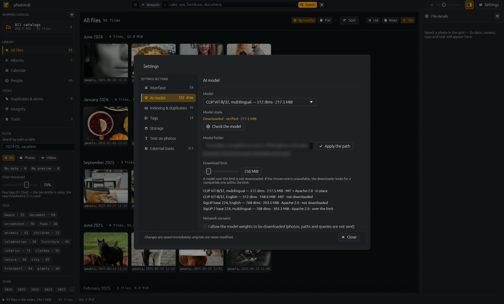

The model catalogue names the size, the licence and the state of every model. **Downloaded ·
verified** means the sha256 of every file matched. A download happens only with the consent tick box
and within the size limit; the binary fetches the weights itself over HTTPS and the offline mode
keeps working. Uploading anything is impossible: the app only downloads.

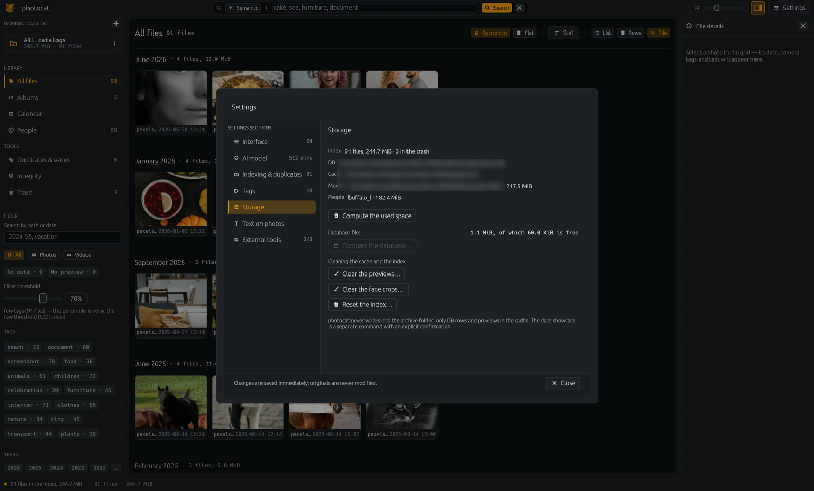

Storage shows the size of the DB, the cache, the models and the faces, and the free pages inside the
database. **Compact the database** runs SQLite `VACUUM`; **Clear previews** and **Clear face crops**
delete only the cache, never the archive; **Forget the index** removes DB rows only. The confirmation
names what is deleted and what is not.
