# Снимки экранов

*English version: [SCREENSHOTS.md](SCREENSHOTS.md).*

Все экраны окна — на английском и на русском. Правила раскладки, по которым они устроены, лежат в
[UI.ru.md](UI.ru.md); у каждого действия есть пара в командной строке — см. [README.ru.md](../README.ru.md).

Снимки сделаны на **демонстрационном каталоге**: 94 стоковых снимка (Pexels), проиндексированных во
временном кэше, с пятью демонстрационными альбомами и семью именами для групп лиц (Anna, Maria, Vera,
Olga, Dmitry, Sofia, Ilya). Имена — только подписи для снимков, а не настоящие люди. Даты съёмки
разнесены по 2016–2026 (демонстрационные EXIF), поэтому календарь показывает архив за одиннадцать
лет; личные пути на снимках замазаны.

## Содержание

- [Главный экран](#главный-экран)
- [Поиск](#поиск)
- [Фильтр по тегу](#фильтр-по-тегу)
- [Полный экран](#полный-экран)
- [Лица](#лица)
- [Альбомы](#альбомы)
- [Календарь](#календарь)
- [Дубли и серии](#дубли-и-серии)
- [Корзина](#корзина)
- [Целостность](#целостность)
- [Настройки](#настройки)

## Главный экран

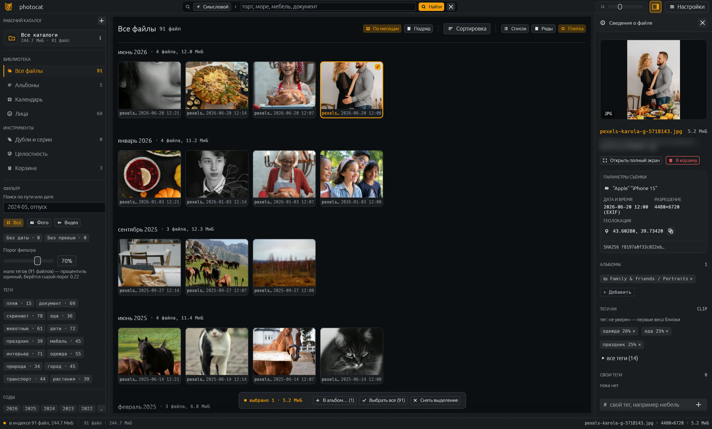

Архив после индексации. Сетка сгруппирована по месяцам и отвечает на вопрос «что лежит в архиве»
раньше, чем что-либо нажато: превью, число файлов и объём каждого месяца. В левой панели — рабочий
каталог, библиотека (все файлы, альбомы, календарь, лица), инструменты (дубли, целостность, корзина),
поле пути и даты, переключатели типа, порог тегов, облако тегов и годы архива. Три вида ячеек —
плитка, ряды и список — делят один ползунок размера (UI.ru.md, раздел «Лента»).

Правая панель — карточка выбранного снимка: превью, путь, **Открыть полный экран** и **В корзину**,
параметры съёмки, sha256, альбомы, теги CLIP с весами (тег — это фильтр: клик добавляет его в фильтр
сетки) и свои теги владельца. Полоса снизу — выделение: сколько выбрано, их объём и **В альбом…**.

## Поиск

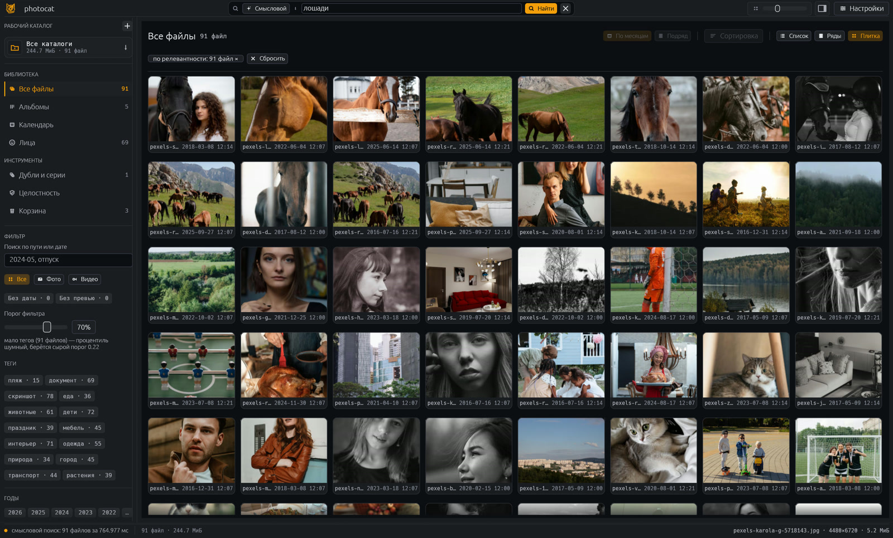

**Смысловой** ищет по смыслу, а не по имени файла: запрос идёт через текстовую башню модели CLIP,
снимки — через графическую, и сравниваются только векторы. Результаты упорядочены по релевантности, и
чип над сеткой это называет; **Сбросить** возвращает порядок архива. То же поле ищет по
распознанному тексту кнопкой **По тексту** (проход `ocr`). Строка статуса называет проход и его время.

Поиск ничего и никуда не отправляет: запрос и векторы остаются на машине.

## Фильтр по тегу

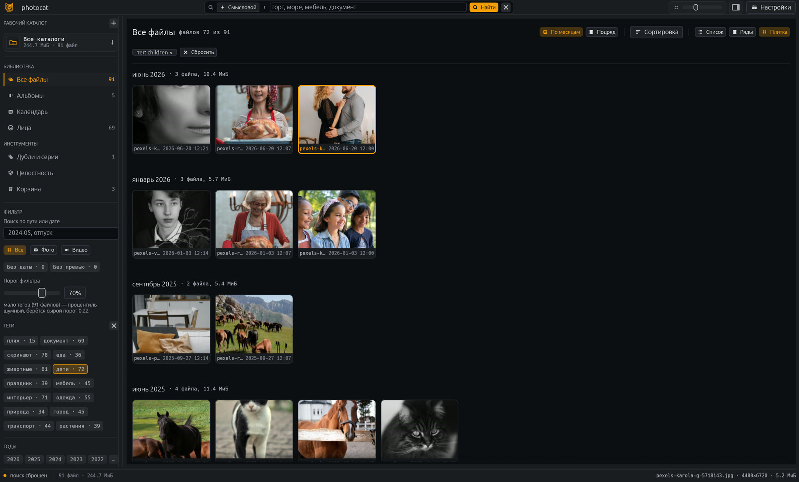

Клик по тегу в левой панели фильтрует сетку. Теги накапливаются (пересечение: каждый выбранный тег
должен пройти), у каждого чипа есть свой **×**, а ползунок порога над облаком — процентиль архива; при
малом числе размеченных файлов он честно об этом говорит. Тот же фильтр есть в командной строке:
`photocat tags` правит словарь, `embed --retag` пересчитывает теги по сохранённым векторам, не
трогая фотографии.

## Полный экран

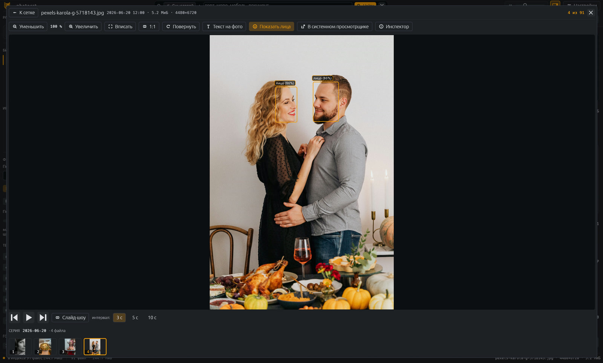

Один снимок на всё окно. Шапка называет файл, его дату, размер и разрешение и позицию в наборе;
строка инструментов приближает, вписывает, переключает на 1:1, поворачивает, распознаёт текст на
видимом кадре, показывает найденные лица, отдаёт файл системному просмотрщику и открывает инспектор.
Полоса серии под снимком — это тот же день: соседний кадр в одном клике или на стрелке, а слайд-шоу
идёт по набору с выбранным интервалом. Кодеки вне возможностей плеера отклоняются с причиной; ничего
не запускается без явного нажатия.

## Лица

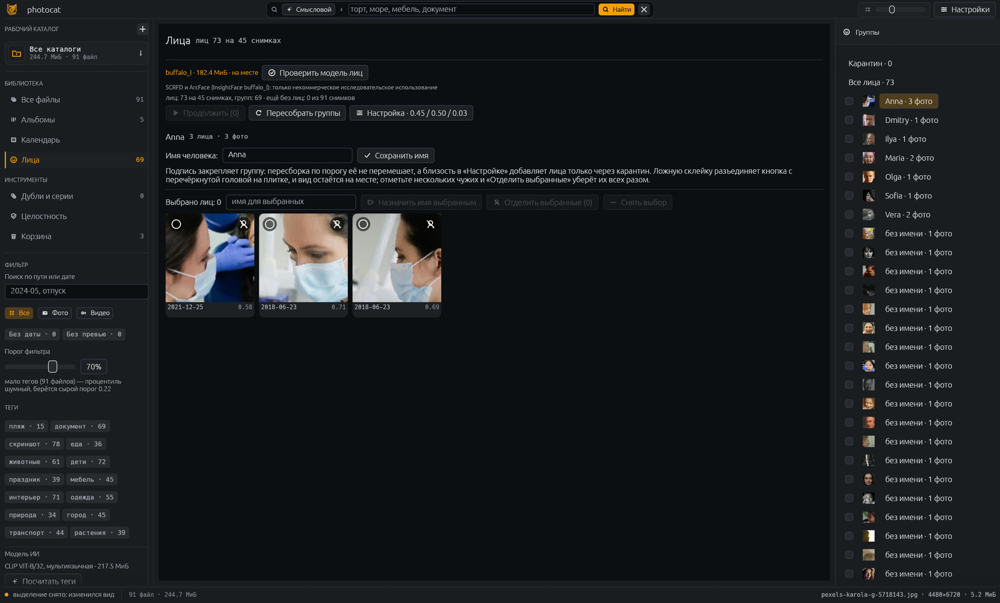

SCRFD находит лица, ArcFace строит векторы, векторы кластеризуются. Группа становится человеком,
когда владелец даёт ей имя; имя хранится в БД и переживает пересборку. Ложное объединение разъединяет
кнопка с перечёркнутой головой на плитке, отмеченные чужие уходят одним нажатием, а ползунки
сопоставления живут за переключателем **Настройка**. Автоматическое сопоставление с уже названным
человеком — только предложение: оно ждёт в **Карантине**, пока владелец его не подтвердит (M26.17).
Лица обрабатываются локально; модель весит 182.4 МиБ и скачивается только с согласия.

## Альбомы

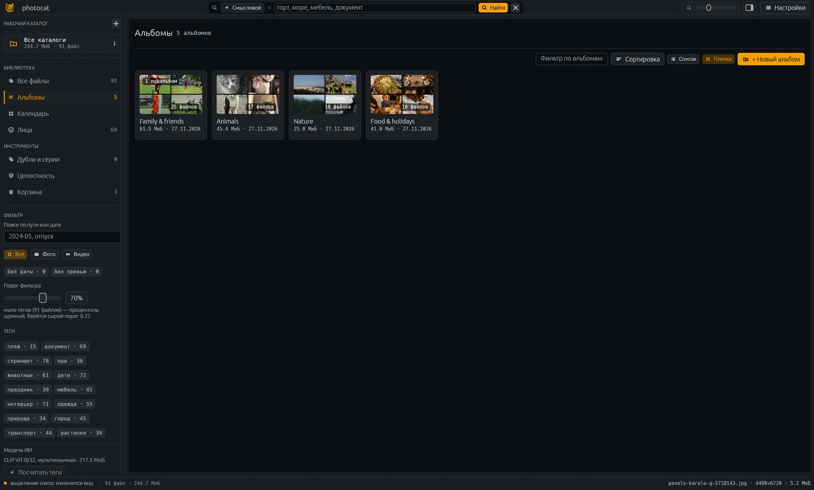

Альбом — это дерево и порядок, и только строки БД: на диске ничего не двигается. Карточки в корне
показывают имя, число файлов, подальбомы и объём; обложка — мозаика из первых четырёх снимков
альбома. Строка управления фильтрует альбомы, сортирует их и переключает карточки и список.

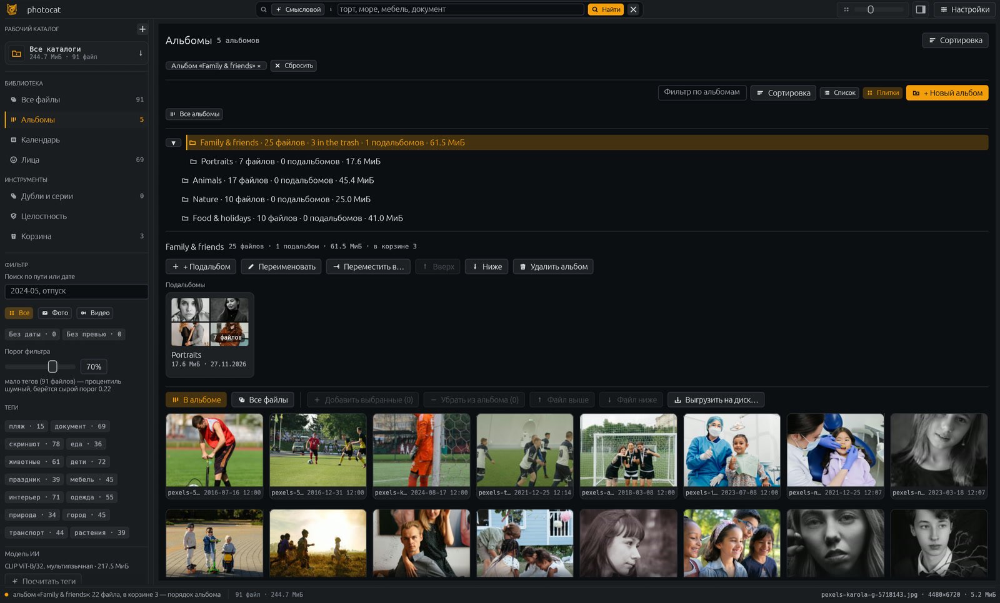

Внутри альбома дерево остаётся на экране, и каждая строка — цель в один клик. Подальбом — карточка
со своей мозаикой. Снимки ниже держат порядок альбома, **Файл выше** и **Файл ниже** его меняют,
**В альбоме / Все файлы** переключает сетку, а **Выгрузить на диск…** пишет настоящие копии
(структура и порядок как в альбоме) только после явного `--apply`; сам архив не меняется.

## Календарь

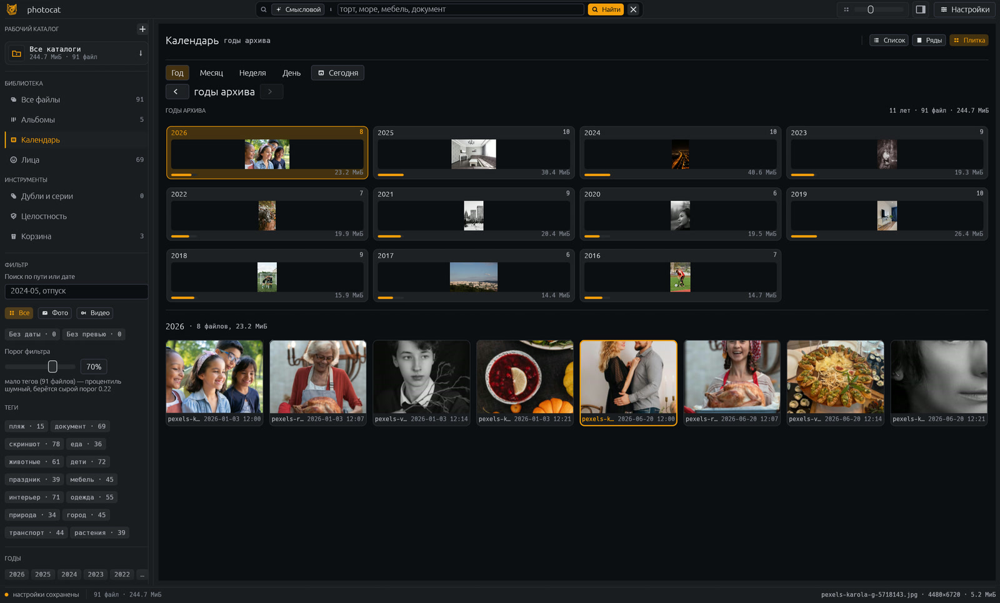

Верхний слой календаря: каждый год архива с числом файлов, объёмом и превью одного из дней. Ниже —
двенадцать месяцев года, недели месяца и дни недели; снимки периода стоят под плитками, поэтому день
открывается, не теряя обзора. Пустой месяц — это честный ноль.

## Дубли и серии

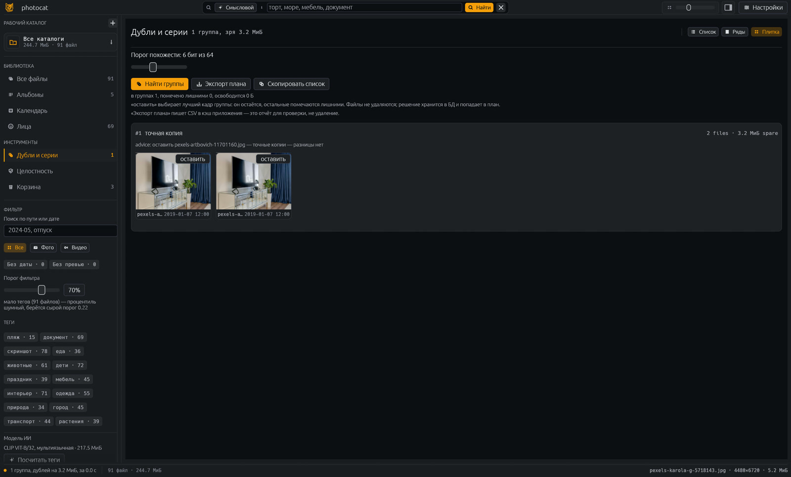

Порог — расстояние Хэмминга по 64-битному dHash. **Найти группы** сравнивает хеши и собирает группы;
**оставить** отмечает кадр, который остаётся, остальные помечаются лишними — решение хранится в БД и
выгружается планом CSV, ни один файл не удаляется. Точные копии узнаются по sha256 и подписаны
отдельно, потому что выбирать между ними незачем. Экран также предупреждает, что низкий порог всё
равно даёт ложные пары.

## Корзина

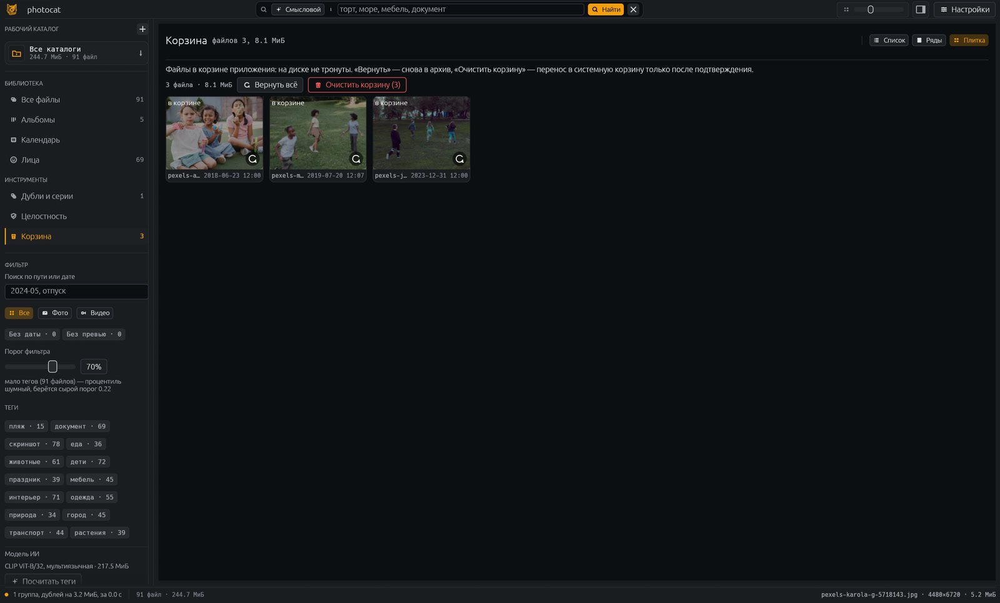

Корзина приложения — это отметка в БД: файлы на диске не тронуты, из обычных видов скрыты, а
**Вернуть** возвращает их в архив. **Очистить корзину** — единственное действие, которое меняет
диск: оно переносит файлы в системную корзину и только после подтверждения. Постоянного удаления в
photocat нет. Заголовок считает файлы и их объём.

## Целостность

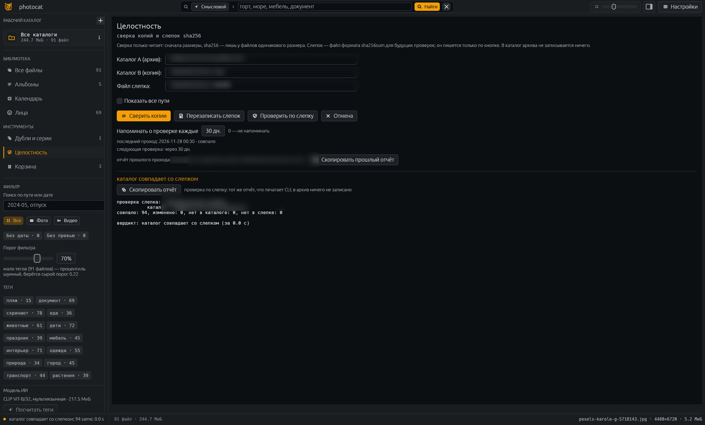

**Сверить копии** сравнивает две папки: сначала размеры, sha256 — только для файлов одинакового
размера. **Записать слепок** делает снимок в формате `sha256sum`, а **Проверить по слепку** сверяет
папку с ним. Для архива все три операции только читают; отчёт пишется в кэш и его можно скопировать.
Последний проход и следующее напоминание — на этом же экране.

## Настройки

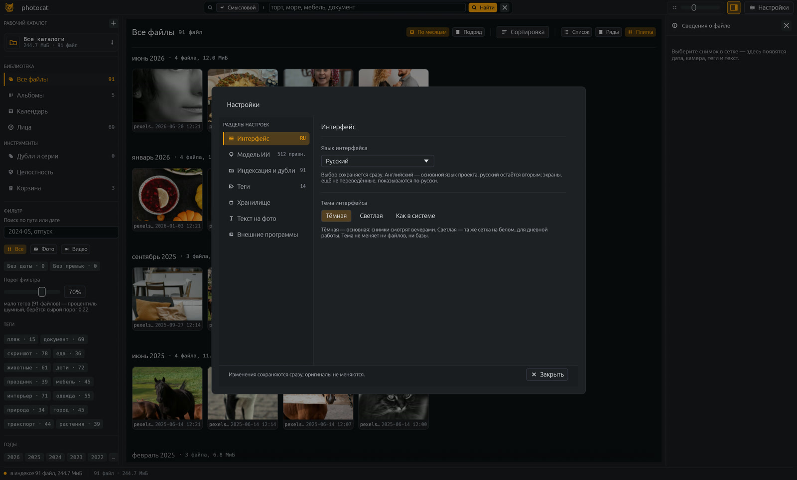

Здесь выбираются язык интерфейса и тема; изменение сохраняется сразу. Тема не меняет ни файлов, ни
базы. В остальных разделах — модель, индексация и дубли, словарь тегов, хранилище, текст на фото и
внешние программы.

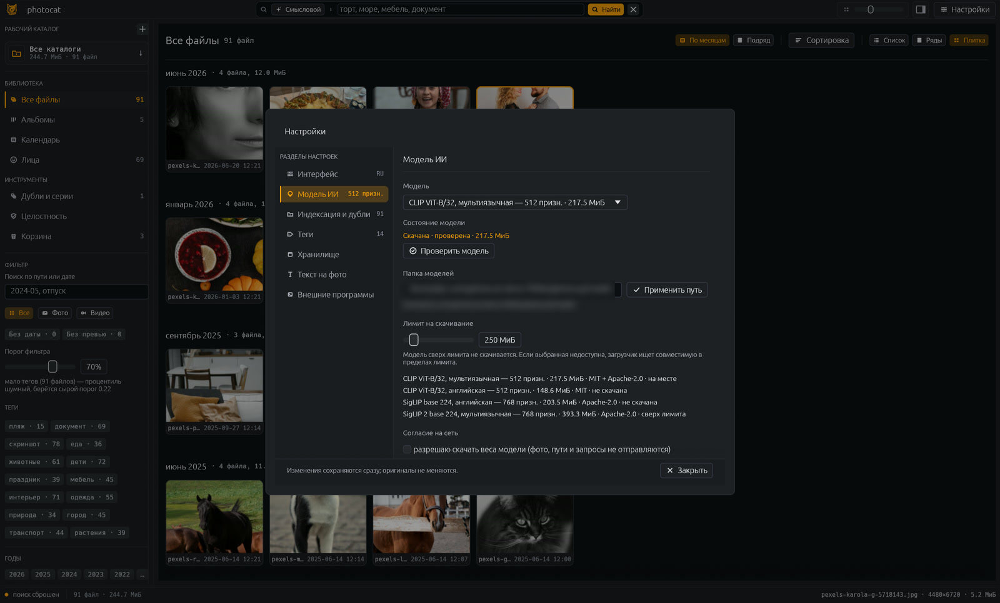

Каталог моделей называет размер, лицензию и состояние каждой модели. **Скачана · проверена** значит,
что sha256 каждого файла совпал. Загрузка идёт только с галочкой согласия и в пределах лимита;
бинарник сам берёт веса по HTTPS, а офлайн-режим продолжает работать. Отправить что-либо наружу
невозможно: приложение только скачивает.

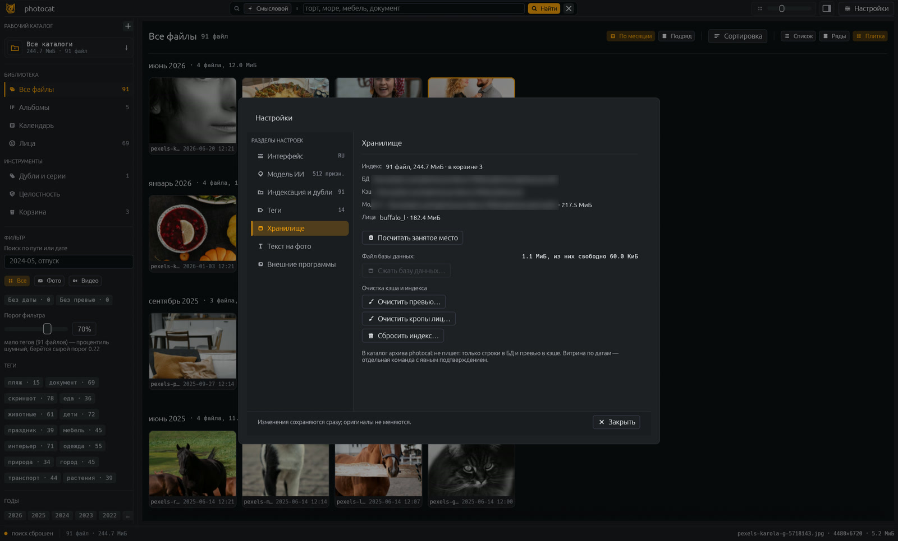

Хранилище показывает размер БД, кэша, моделей и лиц, а также свободные страницы внутри базы.
**Сжать базу данных** запускает SQLite `VACUUM`; **Очистить превью** и **Очистить кропы лиц** удаляют
только кэш, никогда — архив; **Сбросить индекс** удаляет только строки БД. Подтверждение называет,
что удаляется, а что нет.
